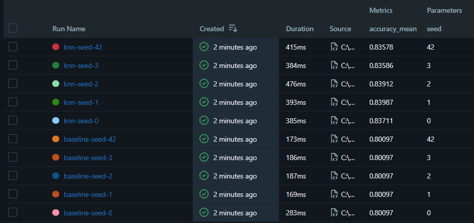

# Pipeline de ML reproducible - ActivaFit (predicción de abandono en gimnasios)

Machine Learning I - Proyecto Integrador
Alumna: Lilian Marcelo Vizcarra - Grupo: 1 - Algoritmo asignado: KNN (K vecinos más cercanos)

**Resumen:** El modelo predice si un socio de un centro deportivo abandonará el servicio (`Dropout` = 1) o no (`Dropout` = 0). Se usa el dataset Sport Services Dataset de Kaggle (archivo `DadosV3.csv`, 14 942 filas y 47 columnas), que corresponde a un centro deportivo de Lisboa (Portugal). Con él se entrena un KNN con K = 5 sobre 8 variables (7 numéricas y 1 categórica) y se compara contra un modelo de referencia (baseline).

## Cómo reproducir
Probado con **Python 3.13.2** en Windows 11.

macOS / Linux:
```bash
git clone [COMPLETAR URL DEL REPOSITORIO] repro && cd repro
python -m venv .venv && source .venv/bin/activate
pip install -r requirements.txt
PYTHONHASHSEED=0 python -m src.prepare_data
PYTHONHASHSEED=0 python -m src.train --seed 42
PYTHONHASHSEED=0 python -m src.run_seeds
```
Windows (PowerShell):
```powershell
git clone [https://github.com/Lily06m/repro-ml-marcelo.git] repro; cd repro
python -m venv .venv; .venv\Scripts\Activate.ps1
pip install -r requirements.txt
$env:PYTHONHASHSEED=0
python -m src.prepare_data
python -m src.train --seed 42
python -m src.run_seeds
```

## Resultado esperado
Una corrida (`--seed 42`):
```
{"seed": 42, "modelo": "knn", "data_md5": "beefd1187915dfb085a7fd1d4afc119f", "accuracy_mean": 0.83578, "accuracy_sd": 0.01182, "f1_macro_mean": 0.71334, "f1_macro_sd": 0.01916, "recall_macro_mean": 0.69373, "recall_macro_sd": 0.01707}
```
Cinco semillas (`results/results_summary.csv`):

| seed | modelo | accuracy_mean | accuracy_sd | f1_macro_mean | f1_macro_sd | recall_macro_mean | recall_macro_sd |
|---|---|---|---|---|---|---|---|
| 0 | baseline | 0.80097 | 0.00016 | 0.44474 | 5e-05 | 0.5 | 0.0 |
| 1 | baseline | 0.80097 | 0.00016 | 0.44474 | 5e-05 | 0.5 | 0.0 |
| 2 | baseline | 0.80097 | 0.00016 | 0.44474 | 5e-05 | 0.5 | 0.0 |
| 3 | baseline | 0.80097 | 0.00016 | 0.44474 | 5e-05 | 0.5 | 0.0 |
| 42 | baseline | 0.80097 | 0.00016 | 0.44474 | 5e-05 | 0.5 | 0.0 |
| 0 | knn | 0.83711 | 0.00917 | 0.71621 | 0.01569 | 0.69662 | 0.01398 |
| 1 | knn | 0.83987 | 0.0024 | 0.72044 | 0.00942 | 0.7004 | 0.01168 |
| 2 | knn | 0.83912 | 0.00653 | 0.71897 | 0.01295 | 0.69881 | 0.01277 |
| 3 | knn | 0.83586 | 0.00738 | 0.71513 | 0.01276 | 0.69631 | 0.01181 |
| 42 | knn | 0.83578 | 0.01182 | 0.71334 | 0.01916 | 0.69373 | 0.01707 |


**Resultado reportado:** accuracy del KNN = 0.8375 ± 0.0019 (media ± DE entre 5 semillas; baseline: 0.8010 ± 0.0000). Como referencia adicional, recall_macro del KNN = 0.6972 ± 0.0025 frente a 0.5000 del baseline.



## Estructura de datos (data lake)
| Zona | Carpeta | Contenido | Regla |
|---|---|---|---|
| raw (bronze) | `data/raw/` | Archivo original | Nunca se edita |
| processed (silver) | `data/processed/` | Datos limpios | Se regenera con `src.prepare_data` |
| results (gold) | `results/` | Métricas | Se regenera con `src.run_seeds` |

Ver `data/MANIFIESTO.md`.

## Qué lo hace reproducible
| Requisito | Cómo se cumple |
|---|---|
| ≥ 6 commits | El repositorio tiene [11] commits hechos a lo largo de la semana, uno por cada parte del entregable. |
| Sin fuga de datos | El imputador, el escalador y el codificador están dentro del `Pipeline`, por lo que en cada fold se ajustan solo con los datos de entrenamiento. El 20 % de prueba se aparta con una partición fija y no se usa. |
| Aleatoriedad fija | Se fija `PYTHONHASHSEED=0`, la semilla de Python y de NumPy, la semilla de la partición (42) y la de la validación cruzada (`random_state=seed`). |
| 5 semillas en MLflow, media ± DE | `src.run_seeds` registra 10 corridas (baseline y KNN con las semillas 0, 1, 2, 3 y 42) y reporta la media ± DE muestral (ddof=1) entre semillas. |
| Mismos datos para todos | Todo el grupo usa `DadosV3.csv`, con el mismo MD5 en raw (`7651033e85d057d52b27b1cfa4a67755`) y en processed (`beefd1187915dfb085a7fd1d4afc119f`). |
| Entorno exacto | `requirements.txt` fija las versiones exactas de numpy, pandas, scikit-learn y mlflow. |

## Prueba del extraño
Probada por Arturo Talaverano, del grupo 1, en Windonws. Enlace al Issue: https://github.com/Lily06m/repro-ml-marcelo/issues/1. Resultado: reprodujo los mismos números (MD5 de processed beefd118..., accuracy 0.83578 ± 0.01182 con la semilla 42), sin dificultades.

## Limitaciones
Primero, el dataset es de un centro deportivo de Lisboa y sus valores monetarios están en euros, pero nuestro grupo lo adapto en caso peruano. Segundo, el 80.1 % de los socios abandona, así que las clases están desbalanceadas y la accuracy sola es engañosa: el baseline logra 0.8010 sin aprender nada. Por eso se reporta también recall_macro. Tercero, variables como `LifetimeValue` o `NumberOfRenewals` se acumulan con el tiempo y podrían contener información posterior al abandono. Cuarto, K = 5 es fijo y no se ajustó. Quinto, el 20 % de prueba no se usó, por lo que no hay estimación final del desempeño.

## Respuestas
1. En este trabajo el imputador, el escalador y el codificador están dentro del Pipeline. Así, en cada fold se ajustan solo con los datos de entrenamiento y no con los de validación. Si escalara todo el dataset antes de validar, la media y la desviación incluirían datos del fold de validación y el resultado saldría más optimista. En KNN esto importa mucho porque las distancias dependen de la escala de las variables.
//
2. El 20 % de prueba debe quedar reservado para la evaluación final, cuando ya se eligió el modelo. Si lo usara para comparar o ajustar, dejaría de ser datos nuevos y la métrica final sería optimista. En este entregable lo aparto con una partición fija (semilla 42) y no lo uso; toda la evaluación se hace con validación cruzada sobre el 80 % restante.
//
3. La desviación estándar mide cuánto cambia la accuracy media cuando cambia la semilla que baraja los folds: en mi KNN es 0.0019. No mide el error del modelo ni su sesgo, ni dice cómo generalizará a datos nuevos. Tampoco mide aleatoriedad interna del algoritmo, porque KNN no tiene inicialización aleatoria. Solo refleja que los folds se arman distinto en cada semilla.
//
4. Sí lo supera. El KNN obtiene accuracy 0.8375 frente a 0.8010 del baseline, una diferencia de 0.0366 que es mayor que la desviación de 0.0019, y lo supera en las cinco semillas. Pero la mejora es modesta porque el 80.1 % de las clases es abandono. Con recall_macro la diferencia se ve mejor: 0.697 frente a 0.500.
//
5. La zona raw guarda el archivo original sin cambios, que es la evidencia de la que parte todo. Si se edita, ya no se puede comprobar qué se hizo con los datos. El MD5 funciona como huella digital: un extraño calcula el MD5 de su `DadosV3.csv` y, si coincide con el del manifiesto (7651033e...), sabe que tiene exactamente el mismo archivo que yo.
//
6. PYTHONHASHSEED se lee cuando Python arranca y fija cómo se calcula el hash de los textos. Si se define dentro del código, el intérprete ya inició y no tiene efecto. Por eso se escribe antes del comando, en la misma línea. Con esto el orden de ciertas estructuras, como los conjuntos, no cambia entre corridas y los resultados se repiten.

## Declaración de uso de IA
Usé Gemini y Claude como apoyo para entender las instrucciones del entregable, adaptar `src/config.py` a mi dataset, detectar que el archivo necesitaba `sep=";"` al leerlo, y redactar borradores del manifiesto y de este README. Yo ejecuté el código en mi computadora, comprobé que las salidas coinciden con las que aparecen aquí, tomé la captura de MLflow y revisé que pueda explicar cada archivo del repositorio.
